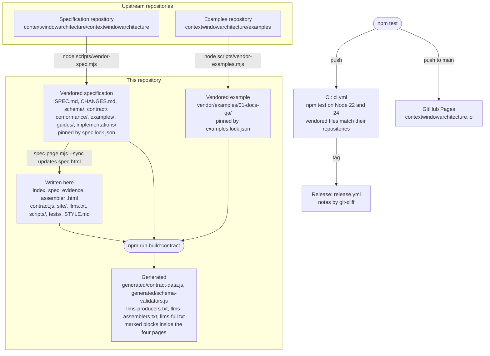

# CWA website

This repository is the source of [contextwindowarchitecture.io](https://contextwindowarchitecture.io), the website for the Context Window Architecture (CWA) specification draft, for anyone who wants to run the site locally or change its pages, scripts and tests.

[](https://github.com/contextwindowarchitecture/website/actions/workflows/ci.yml) [](LICENSE)

**[Quickstart](#quickstart)** · **[Install](#install)** · **[How the pieces connect](#how-the-pieces-connect)** · **[Common tasks](#common-tasks)** · **[Idempotency](#idempotency)** · **[Contributing](#contributing)** · **[Reference](#reference)** · **[License](#license)**

| To read | Go to |
| --- | --- |
| The specification | [Spec page](https://contextwindowarchitecture.io/spec.html), or [`SPEC.md`](SPEC.md) |
| How a profile places context in a request | [Placement page](https://contextwindowarchitecture.io/evidence.html) |
| The assembler implementations and their conformance results | [Assembler page](https://contextwindowarchitecture.io/assembler.html) |
| What an assembler must do, case by case | [`conformance/README.md`](conformance/README.md) |
| How to write a producer or an assembler | [`guides/producers.md`](guides/producers.md), [`guides/assemblers.md`](guides/assemblers.md) |
| The site for a language model or coding agent | [`llms.txt`](llms.txt), [`llms-full.txt`](llms-full.txt) |
| The site's visual rules | [`STYLE.md`](STYLE.md) |

## Quickstart

Requires Node.js 22 or newer and Python 3. See [Install](#install) for details.

```bash
git clone https://github.com/contextwindowarchitecture/website.git
cd website
npm ci
npm test
```

`npm test` ends with a summary whose `fail` line reads `ℹ fail 0`. Then serve the directory:

```bash
python3 -m http.server 8765 --bind 127.0.0.1
```

Open <http://127.0.0.1:8765/>. Serve the pages over HTTP: a page opened from disk cannot fetch `site/glossary.json` for its glossary panel. Any static file server works in place of Python's.

## Install

The site has no install step of its own. GitHub Pages serves the files as committed, the browser installs no packages, and there is no application server. The tools below build and check it.

| Tool | Version | Used for |
| --- | --- | --- |
| [Node.js](https://nodejs.org/) | 22 or newer; CI runs 22 and 24 | The build, the vendor scripts and the tests |
| npm | Ships with Node.js | `npm ci` installs the locked dev dependencies from `package-lock.json`: [Ajv](https://ajv.js.org/) 8.20.0, ajv-formats 3.0.1 and [esbuild](https://esbuild.github.io/) 0.28.2 |
| Python 3 | Any 3.x | Serving the pages locally |
| git | Any | Vendoring refuses a checkout with uncommitted changes |
| [uv](https://docs.astral.sh/uv/) | Any | Regenerating `CHANGELOG.md` at a release (`uvx git-cliff`); maintainers only |

To re-vendor the specification or the example, clone their repositories beside this one:

```bash
git clone https://github.com/contextwindowarchitecture/contextwindowarchitecture.git ../contextwindowarchitecture
git clone https://github.com/contextwindowarchitecture/examples.git ../examples
```

## How the pieces connect


<details>
<summary>Diagram source (Mermaid)</summary>



</details>

Each file in this repository belongs to one of three groups, and the group decides how to change it:

| Group | Examples | How to change it |
| --- | --- | --- |
| **Vendored** | `SPEC.md`, `schema/`, `contract/`, `conformance/`, `vendor/examples/` | Change it in its own repository, then re-vendor. `npm test` fails when a vendored file differs from its lock. |
| **Written here** | The four pages, `contract.js`, `site/`, `llms.txt`, `scripts/`, `tests/` | Edit it directly. |
| **Generated** | `generated/`, `llms-producers.txt`, `llms-assemblers.txt`, `llms-full.txt`, marked page blocks | Change its source, then run `npm run build:contract`. `npm test` fails when a generated file is stale. |

Commit generated files with their sources. GitHub Pages serves the repository root of `main` as committed and does not wait for CI, so run `npm test` before every push to `main`. The [Reference](#reference) section lists every file and what it is responsible for.

## Common tasks

| Task | Command |
| --- | --- |
| Install the locked dev dependencies | `npm ci` |
| Run every check | `npm test` |
| Rebuild the generated files | `npm run build:contract` |
| Check that the generated files are current | `npm run check:generated` |
| Check the vendored specification against `spec.lock.json` | `npm run verify:spec` |
| Check the vendored example against `examples.lock.json` | `npm run verify:examples` |
| Vendor the specification from a checkout | `node scripts/vendor-spec.mjs ../contextwindowarchitecture` |
| Compare the vendored specification with a checkout | `node scripts/vendor-spec.mjs ../contextwindowarchitecture --check` |
| Vendor the example from a checkout | `node scripts/vendor-examples.mjs ../examples` |
| Compare the vendored example with a checkout | `node scripts/vendor-examples.mjs ../examples --check` |
| Check that the Spec page says what `SPEC.md` says | `node scripts/spec-page.mjs --check` |
| Serve the site locally | `python3 -m http.server 8765 --bind 127.0.0.1` |
| Regenerate the changelog at a release | `uvx git-cliff --tag vX.Y.Z -o CHANGELOG.md` |
| Release a tag pushed before `release.yml` existed | `gh workflow run release.yml -f tag=<tag>` |

After a vendor, run `npm run build:contract && npm test`.

## Idempotency

Every command that writes tracked files can run again safely. With unchanged inputs, a second run changes no tracked file, and `git status --short` prints nothing.

| Command | Second run with the same inputs | Confirm with |
| --- | --- | --- |
| `npm run build:contract` | Writes byte-identical files | `npm run check:generated` exits 0 |
| `node scripts/vendor-spec.mjs ../contextwindowarchitecture` | Prints `0 written, 0 removed` when the checkout is at the locked commit | `node scripts/vendor-spec.mjs ../contextwindowarchitecture --check` exits 0 |
| `node scripts/vendor-examples.mjs ../examples` | Prints `0 written, 0 removed` when the checkout is at the locked commit | `node scripts/vendor-examples.mjs ../examples --check` exits 0 |
| `node scripts/spec-page.mjs --sync` | Rewrites only the page blocks whose text `SPEC.md` changed; prints `The Spec page already says what SPEC.md says.` | `node scripts/spec-page.mjs --check` exits 0 |
| `npm ci` | Deletes `node_modules/` and reinstalls the versions in `package-lock.json` | `npm ls` |

These commands leave the working tree unchanged: `npm test`, `npm run check:generated`, `npm run verify:spec`, `npm run verify:examples`, and every `--check` and `--verify` form of the scripts.

A vendor refuses a checkout with uncommitted changes, so each lock names a commit that holds exactly what was copied. A vendor also removes vendored files it no longer copies.

## Contributing

Choose where a change goes before writing it:

| You want to | Go to |
| --- | --- |
| Report a problem with, or propose a change to, the specification, a schema or a conformance case | [Specification issues](https://github.com/contextwindowarchitecture/contextwindowarchitecture/issues/new/choose) |
| Ask a question about the specification | [Specification Discussions](https://github.com/contextwindowarchitecture/contextwindowarchitecture/discussions) |
| Change the example app the home page shows | [contextwindowarchitecture/examples](https://github.com/contextwindowarchitecture/examples) |
| Report a problem with a page, a script or a test on this site | [Issues in this repository](https://github.com/contextwindowarchitecture/website/issues) |
| Fix a page, a script, a test or the glossary | A pull request to this repository, as below |

To open a pull request:

1. Fork this repository and create a branch.
2. Edit only files in the **written here** group. [`STYLE.md`](STYLE.md) holds the tokens, type scale and component recipes for page changes.
3. If you changed a source of a generated file, run `npm run build:contract`.
4. Run `npm test` and confirm `ℹ fail 0`.
5. Commit the generated files together with their sources.
6. Write the commit message as a [Conventional Commit](https://www.conventionalcommits.org/), for example `fix(site): wrap code-panel headers on a phone`. [`cliff.toml`](cliff.toml) leaves any other message out of the changelog.
7. Sign off each commit with `git commit -s` to certify the [Developer Certificate of Origin](https://developercertificate.org/), as the specification repository requires. CI here does not check the sign-off.
8. Open the pull request. CI runs `npm test` on Node 22 and 24 and compares the vendored files with their repositories at the locked commits.

The tests set a floor for page changes. [`tests/accessibility.test.mjs`](tests/accessibility.test.mjs) requires every text colour to reach a 4.5:1 contrast ratio on both backgrounds in both themes, a reduced-motion rule and a no-script note on every page, and a live region for the simulator. The glossary tests hold every quoted sentence in [`site/glossary.json`](site/glossary.json) to `SPEC.md`.

## Reference

<details>
<summary><strong>Vendored from the specification repository</strong></summary>

The specification is written in [contextwindowarchitecture/contextwindowarchitecture](https://github.com/contextwindowarchitecture/contextwindowarchitecture). `SPEC.md`, `CHANGES.md`, `schema/`, `contract/`, `conformance/`, `examples/`, `guides/` and `implementations/` are copies of that repository at the commit [`spec.lock.json`](spec.lock.json) names. Never edit them here: change them there, then run `node scripts/vendor-spec.mjs ../contextwindowarchitecture`.

| Source | Responsibility |
| --- | --- |
| [`contract/requirements.json`](contract/requirements.json) | Permanent requirement IDs (R-1 through R-26; new ones append) and requirement text |
| [`CHANGES.md`](CHANGES.md) | Every revision of the specification, newest first. The build writes the Spec page's draft date from it; the history is read there, and the page carries no changelog |
| [`SPEC.md`](SPEC.md) | The normative text. It is written by hand, except the blocks between its `generated` markers, which `python3 conformance/check.py --write` writes from `contract/requirements.json`, `contract/model.json` and `examples/profiles.json`, with its draft date from `CHANGES.md` |
| [`schema/`](schema/) | JSON Schemas for items, traces, placement profiles, producer batches, conflict groups, route policies and snapshots |
| [`conformance/cases/`](conformance/cases/) | Language-neutral assembler test cases: a snapshot in, the expected trace and payload out (see [`conformance/README.md`](conformance/README.md)) |
| [`conformance/rejections/`](conformance/rejections/) | Snapshots that each break exactly one snapshot check. An assembler must reject each before assembly, with no trace (R-17) |
| [`contract/reasons.json`](contract/reasons.json) | Canonical exclusion and refusal reason codes, listed in the llms guides |
| [`contract/assembler-scope.json`](contract/assembler-scope.json) | What an assembler can verify per requirement; generates the scope column of the Assembler matrix |
| [`implementations/`](implementations/) | Each listed implementation's conformance report, stored untouched beside its source (repository, commit, tags) and the digests of the cases at the commit it ran against, plus the Python reference assembler's status claims (`python.status.json`). `index.json` lists them in the Assembler page's order. Reports are imported in the specification repository with `conformance/import_report.py` and reach this site with the next vendor |
| [`contract/slot-defaults.json`](contract/slot-defaults.json) | Default roles, protection tiers and policy fields |
| [`contract/model.json`](contract/model.json) | The planes, slots, item fields, authority values, conflict rules, pipeline stages and tests the Spec page lists, in its order. It generates those lists on the Spec page and fills the slot and authority tables in the llms guides |
| [`examples/`](examples/) | A concrete item, producer batch, profiles and the route policies they name, a payload and its matching trace, and the sample message request with its snapshot |
| [`guides/producers.md`](guides/producers.md), [`guides/assemblers.md`](guides/assemblers.md) | The producer and assembler guides, written by hand around the blocks between their `generated` markers, which `python3 conformance/check.py --write` writes from the contract files and `implementations/`. Links to the specification's files are relative; links to site pages are absolute |

```bash
node scripts/vendor-spec.mjs ../contextwindowarchitecture           # copy, remove what the spec no longer publishes, write spec.lock.json, sync the Spec page
node scripts/vendor-spec.mjs ../contextwindowarchitecture --check   # exit 1 if the vendored files differ from that checkout
node scripts/vendor-spec.mjs --verify                               # exit 1 if a vendored file differs from the lock; npm test runs this
```

A vendor prints the revisions `CHANGES.md` gained since the last vendor; check the pages that restate them. It then syncs the Spec page to the new `SPEC.md`. CI checks the vendored files against the specification repository at the locked commit, and a tag is released only against that repository at the same tag, so tag it there first.

The specification's own checks run in that repository, in Python: `uv run python conformance/check.py` and `uv run python -m unittest discover -s conformance/tests`. Implementations are listed there too, with `conformance/import_report.py`.

</details>

<details>
<summary><strong>Vendored from the examples repository</strong></summary>

`vendor/examples/` holds the files the home page shows from [contextwindowarchitecture/examples](https://github.com/contextwindowarchitecture/examples), at the paths they have there and the commit [`examples.lock.json`](examples.lock.json) names: the 01-docs-qa help-center bot's `before.py`, `after.py` and `context.py`, and two of its committed scenarios. `01-answer` has a snapshot, a trace and a payload; `03-off-topic` is refused, so it has a snapshot and a trace.

Never edit them: change them there, then run `node scripts/vendor-examples.mjs ../examples` (`--check` compares with a checkout, `--verify` with the lock). The examples' CI regenerates their scenarios on every push, so a vendor can change what the home page shows; review its diff. CI checks the vendored files against the examples repository at the locked commit.

</details>

<details>
<summary><strong>Written here</strong></summary>

| Source | Responsibility |
| --- | --- |
| [`spec.html`](spec.html) | Renders `SPEC.md` from its requirement index to section 6 with the site's design, leaving Future work in `SPEC.md`, and names the specification commit it renders. A vendor runs `node scripts/spec-page.mjs --sync`, which rewrites the page blocks whose text changed and lays out added ones as the page does. The tests fail while the page, read back by `scripts/spec-markdown.mjs`, differs from `SPEC.md` |
| [`index.html`](index.html), [`evidence.html`](evidence.html), [`assembler.html`](assembler.html) | The Home, Placement and Assembler pages. Each repeats the token block [`STYLE.md`](STYLE.md) documents |
| [`contract.js`](contract.js) | Shared local semantic checks used by the tests |
| [`support.js`](support.js) | The pages' runtime, generated outside this repository; do not edit it |
| [`site/*.txt`](site/), [`site/cwa.md`](site/cwa.md) | Integration guidance and a rendering template for agents, linked from `llms.txt` and owned by the site |
| `site/logo-light.png`, `site/logo-dark.png` | The organisation's logo from contextwindowarchitecture/.github, downscaled, one per theme |
| [`site/glossary.json`](site/glossary.json), [`site/glossary.js`](site/glossary.js) | Every term the site uses, defined in the specification's own words with where the site defines it. The module loads and searches it for the glossary panel every page opens. Tests hold each quoted sentence to `SPEC.md`, each anchor to its page, and the planes and slots to `contract/model.json` |
| [`llms.txt`](llms.txt) | The site index for language models and coding agents in the [llms.txt](https://llmstxt.org/) format, written by hand |
| [`scripts/`](scripts/) | The build, the vendor scripts and the Spec page sync |
| [`tests/`](tests/) | The [`node:test`](https://nodejs.org/api/test.html) suites `npm test` runs |
| [`STYLE.md`](STYLE.md) | The site's visual language: tokens, type scale, spacing and component recipes |

</details>

<details>
<summary><strong>Generated by <code>npm run build:contract</code></strong></summary>

The build writes:

- `generated/contract-data.js` and `generated/schema-validators.js`. [Ajv](https://ajv.js.org/standalone.html) compiles the JSON Schemas at build time, so the browser module has no remote dependency or runtime schema compiler. See [`THIRD_PARTY_NOTICES.md`](THIRD_PARTY_NOTICES.md).
- The requirement arrays and the model lists in the Spec page, from `contract/requirements.json` and `contract/model.json`.
- The first profile example in Placement and Spec.
- The Spec page's draft date, from `CHANGES.md`.
- The implementations table on the Assembler page, from the reports in `implementations/`.
- The home page's example blocks, from `vendor/examples/` and `site/measured.json`.
- `llms-producers.txt` and `llms-assemblers.txt`, from `guides/`, with links resolved against the site and each implementation's count added. The build stops when a guide's generated block differs from its own rendering.
- `llms-full.txt`, which joins `llms.txt`, spec §1, the slots and authority values, both guides, every requirement and `conformance/README.md` into one file.

Each generated page block sits between `<!-- NAME_START -->` and `<!-- NAME_END -->` markers. Edit the source, never the block.

</details>

<details>
<summary><strong>Releases and changelogs</strong></summary>

- CI ([`.github/workflows/ci.yml`](.github/workflows/ci.yml)) runs `npm ci` and `npm test` on Node 22 and 24, and checks the vendored files against both upstream repositories at their locked commits.
- Each tag gets a GitHub release once CI passes on the tagged commit ([`.github/workflows/release.yml`](.github/workflows/release.yml)), with the tag's own commits as notes, written by [git-cliff](https://git-cliff.org/). A tag that is not `vX.Y.Z`, such as `draft-release`, is a prerelease. Release a tag pushed before the workflow existed with `gh workflow run release.yml -f tag=<tag>`.
- [`CHANGELOG.md`](CHANGELOG.md) is generated from the commit history with git-cliff ([`cliff.toml`](cliff.toml)). Regenerate it at a release with `uvx git-cliff --tag vX.Y.Z -o CHANGELOG.md`; never edit it by hand.
- [`CHANGES.md`](CHANGES.md) is the specification's own revision history, vendored from the specification repository.

</details>

<details>
<summary><strong>What the checks establish</strong></summary>

**Covered.** The suite checks field types and enums, timestamps, required fields, defaults, producer handoff shape, selected authority and admission constraints, protected-slot and budget invariants, refusal representation, and instruction-versus-fact conflict trace shape. It also checks profile exports, full migrator body preservation, generated-document synchronization and component rendering. [`tests/accessibility.test.mjs`](tests/accessibility.test.mjs) holds the site to an accessibility floor: every colour the pages use as text clears 4.5:1 on both backgrounds in both themes and `STYLE.md` lists the same values, every page carries a reduced-motion rule and a no-script note, and the simulator announces changes through a live region.

**Local checks only.** `checkItem()` and `checkTrace()` returning `valid: true` means their documented local checks pass. It does not authorize sending a request or executing a tool. Authenticate the producer in application code; never construct trusted context by spreading an item's fields into it. The website has no authenticated route context and reports only local checks.

**Fixtures and token counts.** The concrete trace uses `examples/fixture-profile.json`, separate from the six illustrative route profiles, and its hash matches `examples/payload.txt`. Its `fixture-whitespace/v1` tokenizer counts non-whitespace runs only; it is a test fixture and models no real tokenizer. Real assembly counts with the target model's tokenizer, or with an estimating one such as `estimate-utf8/v1` and a `budget.margin_percent` that covers its error (R-16), and counts everything the renderer emits as text, wrappers and repeated content included. Hash the exact rendered UTF-8 bytes; preserve the immutable snapshot separately for replay.

**Cross-implementation example.** `examples/messages-payload.json` is the exact `cwa-messages/v1` payload that the Python, TypeScript, Go and Rust assemblers produce from `examples/messages-snapshot.json` under `policy-first-chat/v1`, its `support-chat` route policy and `estimate-utf8/v1`. The suite recomputes it from the snapshot. `examples/messages-trace.json` is the trace all four emit for that snapshot, identical except for the `trace_id` each draws at random; the suite checks it against the snapshot, its digest and the payload's hash.

**Not covered.** The suite does not implement or certify an assembler, detect semantic contradictions in prose, establish factual truth, authenticate remote sources, prove compression fidelity, or benchmark model outcomes. All six example profiles are unevaluated. A production conformance suite must exercise the actual implementation's admission, conflict resolution, fitting, rendering and replay behavior.

</details>

## License

Apache License 2.0: see [LICENSE](LICENSE) and [NOTICE](NOTICE). This covers the specification, schemas, conformance cases and site. The generated validator and the header's GitHub icons include MIT-licensed code listed in [`THIRD_PARTY_NOTICES.md`](THIRD_PARTY_NOTICES.md).
